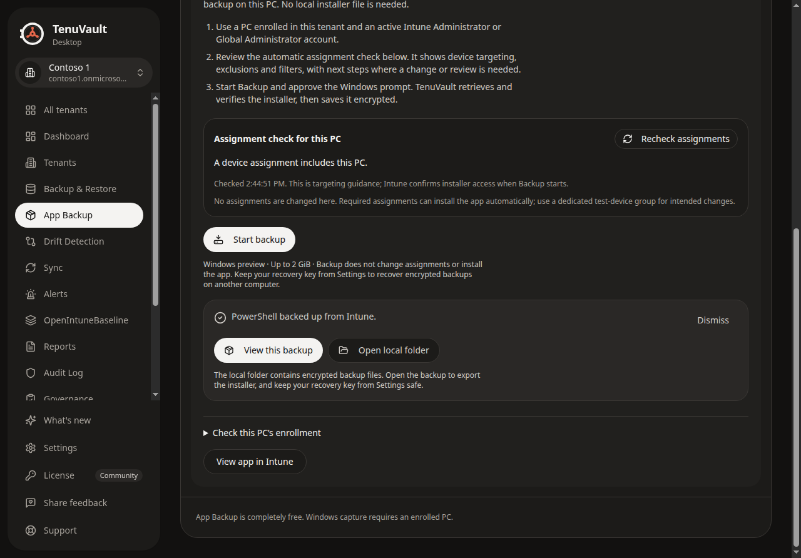
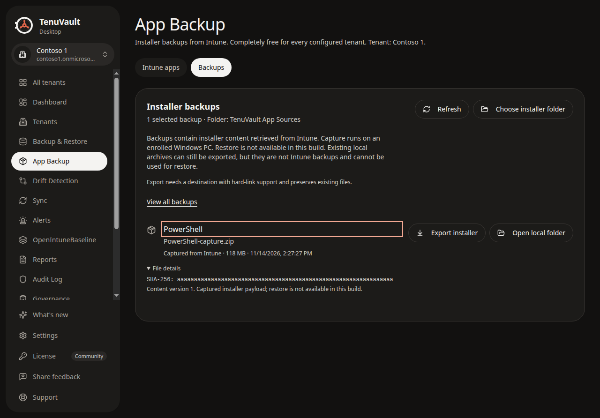
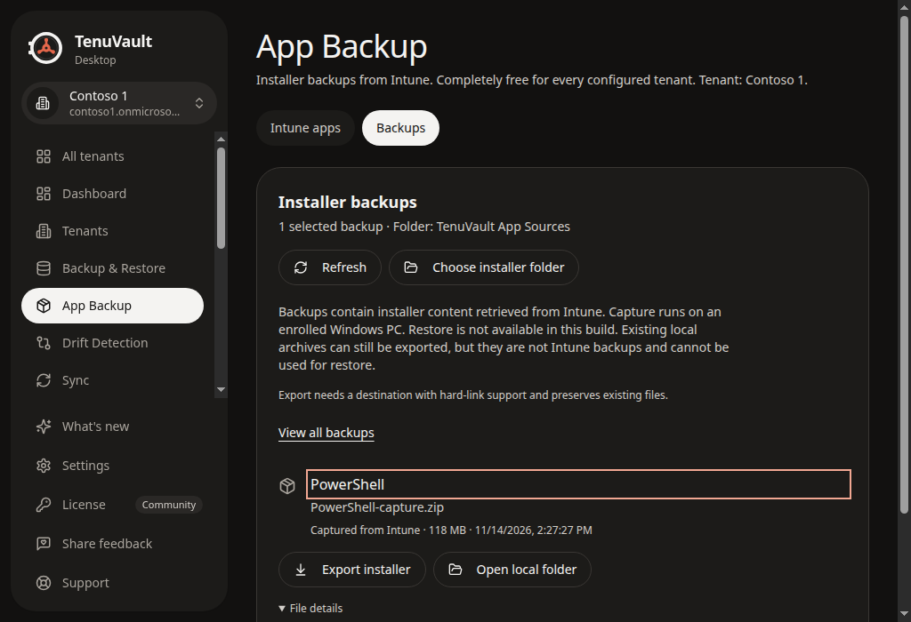

# Backup completion actions, 2026-11-14

The built Electron renderer offers **View this backup** and **Open local folder** after a successful capture. The first selects the returned source ID, focuses its heading and opens its details. The second requests that source’s encrypted folder through trusted main-process IPC. **View all backups** returns to the full catalog. Both export and folder controls remain together at the minimum desktop width.

These screenshots use synthetic app, capture and catalog responses in an isolated renderer frame. They prove the displayed flow and action arguments, not a live Microsoft capture or actual file-manager launch. The separate [signed Windows evidence](../windows-signed-capture-2026-11-14.json) records the real capture, native export and restart at commit `21fc27d`.

Validation of the completion changes:

- 137 focused tests passed on the Windows mini PC, including source-directory authentication, junction refusal, wrong-tenant/key refusal, capture-result publication and exact-source navigation.
- 5,452 tests passed locally, with two existing skips across 375 files. The final layout adjustment additionally passed all 20 renderer tests across three files.
- Typecheck, app build and documentation build passed. Lint reports four existing warnings outside this change.
- All built-desktop smoke checks passed against the final build. The completion checks use two backups with the same app name, verify that only the returned ID is selected, verify folder-action tenant/source arguments, check focus and test the 1024px minimum width.

An earlier smoke run was invalidated when a concurrent local rebuild replaced its lazy-loaded bundles. The final run used an unchanged build and passed.

