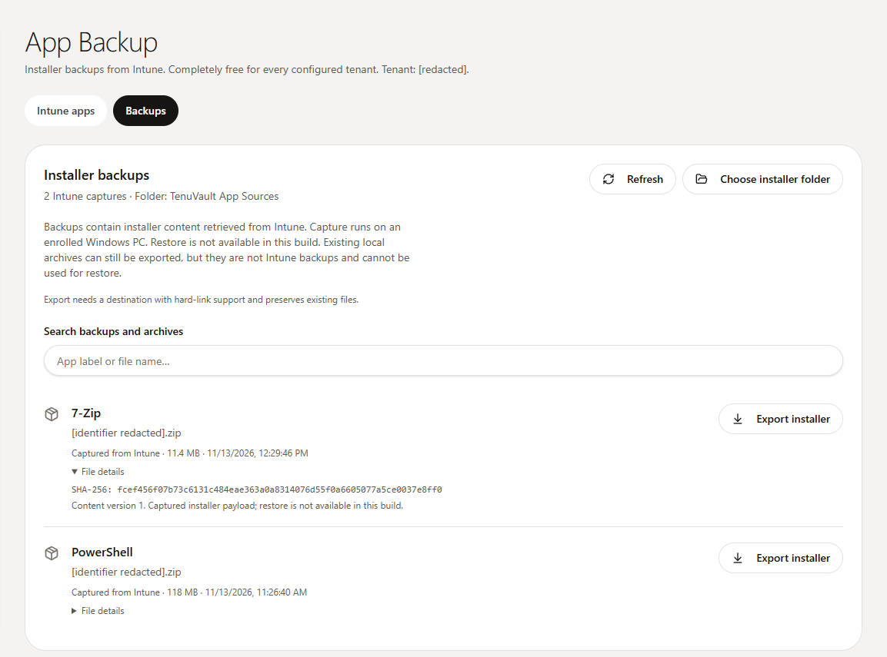
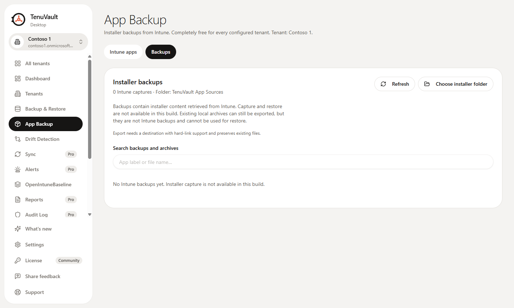
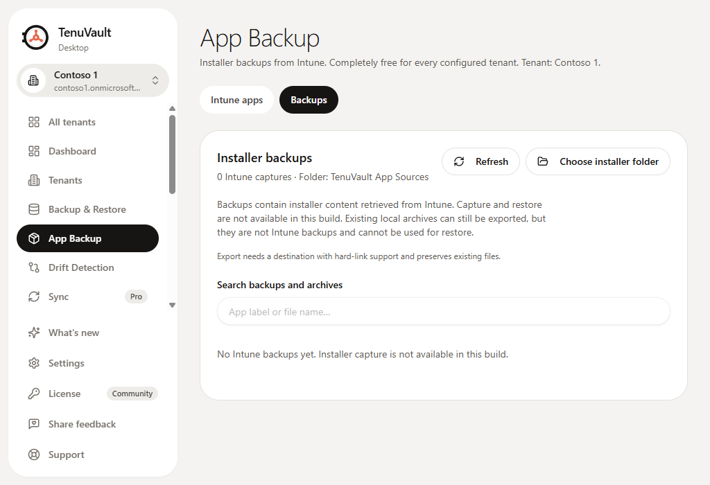

# Windows App Backup validation, 2026-11-13

## Release verification follow-up

**Signed Windows capture, export and restart passed on 2026-11-14.** The enrolled mini PC ran the signed app/helper pair from commit `21fc27d75d1420b5022bb966b43d69df886e9ccc`, built by [signed verification run 43503338828](https://github.com/ugurkocde/TenuVault/actions/runs/43503338828). Both Authenticode signatures were valid with matching publishers. The user clicked Start backup in the ordinary desktop session and approved Windows consent. The app captured PowerShell, native export matched the independent payload hash, and restart retained all three encrypted backups without warnings. No staging directory, unexpected file, helper or consent process remained.

The production control was verified in both disabled and enabled states with fresh nonce-bound Ed25519 claims and the release-pinned public key. While disabled, the actual signed app refused capture before Windows consent and retained both existing backups. With the enabled policy, the successful signed capture above completed. The signed helper also refused a foreign-publisher Node parent before accepting a request. These results supersede the signed-package and deployed-control items previously marked pending below. [Machine-readable signed evidence](app-backup-evidence/windows-signed-capture-2026-11-14.json).

Earlier automation-driven attempts ended with Windows cancellation and no artifact. The successful case used a direct click on the Windows desktop; those cancelled attempts are not counted as capture successes. The new completion buttons were added afterward and are verified separately by renderer, service and built-app tests, not claimed as part of the `21fc27d` binary test.

The enrolled mini PC passed 32 compiled helper checks with `REQUIRE_SIGNATURE` enabled,
including rejection of unsigned images and absent, malformed or unsupported requester
roles. These role cases use fixtures, not a real non-admin Microsoft session. No non-admin
test account is available, so that live case remains untested.

Manual CI can now build a signed Windows verification artifact without publishing a release.
Both manual verification and release packaging validate the app and helper's Authenticode
signatures and expected matching publisher. The signed device result is recorded above.

The first signed CI run found a real packaging failure: the app was signed but the helper
under `resources/app-backup` was not. An explicit packaging hook now signs that copy for
each Windows architecture, with regression tests for signing failure and unsigned PR builds.
The corrected signed build passed and ran on the PC as recorded above.

The signed remote control now has desktop and companion-service implementations. Thirty
desktop policy tests and 17 service cases cover signature, purpose, nonce replay, expiry,
explicit disable, version floors, malformed replies and network refusal. The actual server
and desktop modules also passed an enable/disable/version-floor contract check. These are
local tests; deployed control verification and signed app capture are recorded separately above.

## Automatic assignment-check follow-up

The packaged app now checks assignments automatically when a Windows app's Backup panel opens. Real delegated-session checks passed for device targeting (PowerShell), user targeting (Brave) and an include filter requiring review (7-Zip). No capture was started and neither retained backup changed. See the [assignment-check evidence and limits](app-backup-evidence/assignment-checks-2026-11-13/README.md).

## Current app-driven capture validation

The Windows helper and Backup action are now implemented. A normal desktop session on the enrolled mini PC completed PowerShell capture through the real compiled helper after the administrator signed in and approved Windows consent. The app verified and stored a 123,779,448-byte payload. Native export produced the same SHA-256 as the independent earlier lab capture: `aab979dcb289d34da2b50328b67613a896ffac542154946b158e71a6f14df3da`.

The packaged app reopened that backup after restart with no catalog warnings. The verified 7-Zip fixture then completed capture and native export in the packaged app at `ef1a704`. Its 11,959,010-byte export matched the independent lab capture SHA-256, `fcef456f07b73c6131c484eae363a0a8314076d55f0a6605077a5ce0037e8ff0`. The earlier PowerShell export remained unchanged. Restart reopened both encrypted captures with no catalog warnings.

Negative app-driven cases:

| Case | Observed result |
| --- | --- |
| Brave without device content access | Real HTTP 403 after user-approved helper consent; targeting guidance shown; both backups preserved |
| PowerShell cancellation during download | Clicked the visible Cancel operation control after progress showed 619.2 kB of 118 MB; neutral cancellation message; no new backup |
| Cancelled Windows approval | No new catalog item |
| User-context Git fixture | Refused before helper launch by the preview UI |
| Duplicate 7-Zip record with no committed content | Refused before Windows consent; catalog unchanged |

After the HTTP 403 and download-cancellation cases, the store contained exactly the two existing encrypted artifacts and manifests, no staging directories and no unexpected files. No capture helper or consent process remained.

The empty duplicate app record returned `committedContentVersion: null`, confirmed with Lokka beta. The follow-up replaces a generic helper failure with an explicit main-process refusal before Windows consent and independently handles the null field in the native helper. The rebuilt packaged app verified this refusal. The follow-up passed 224 focused Windows tests across 15 files, 23 native checks, 38 local focused tests and typecheck; all six packaged fuses remain correct.

Local validation: 5,254 tests passed, two existing skips, 366 files; typecheck and app build passed; lint has four existing warnings. On the mini PC, 210 focused tests across 14 files and 15 compiled native helper checks passed. The native checks include token age/skew/tenant/scope refusals, bounded framing, first-instance pipe refusal and unsigned-image rejection.

The app’s actual delegated session passed live Graph beta authorization in the helper. Lokka beta checks remain app-only and supplement this evidence with endpoint, field, paging and error verification. No tenant assignments or installed applications were changed.

Release limits: this is an unsigned PR package. A signed app/helper pair, broader endpoint-protection coverage, a non-admin Microsoft requester refusal, user-context capture, macOS retrieval and restore are not established by these tests. Earlier laboratory results below are preserved as historical component evidence.

Machine-readable results: [app-flow evidence](app-backup-evidence/windows-app-flow-2026-11-13.json). The screenshot shows the real retained 7-Zip and PowerShell captures in the packaged app; only the tenant label and source identifier were redacted.

## Historical component validation at 72f0ad5

**Acceptance at that earlier commit: blocked.** That app could not start an Intune installer capture. The Windows tests below validate the packaged UI, enrollment checks and capture-ingestion components; they do not establish a working user-facing backup or restore.

Tested commit: `72f0ad5143a49f443b540923f64d9552aff13c49`, PR #352. The tests ran on the enrolled Windows mini PC over the existing authorized SSH connection. Windows build 26200, Node 26.7.0, and the Intune Management Extension were present. The installed app was older, so testing used an isolated checkout and the exact x64 package from [CI run 43392091957](https://github.com/ugurkocde/TenuVault/actions/runs/43392091957), without replacing the installed app or its profile.

## Results

| Test | Result | Scope |
| --- | --- | --- |
| Focused App Backup suites on Windows | 200 passed, zero failures or skips across 13 files | Ingestion, corruption, truncation, tenant/content isolation, cancellation, real child-process death, reconciliation, key recovery, free access, inventory/details/scripts and renderer behavior |
| Packaged Electron desktop smoke | 58 checks passed, exit 0 | Ran in the interactive desktop with a limited token and a disposable profile. Includes offline catalog access, no manual installer picker, free access and minimum-window layout. Inventory/UI fixtures are synthetic, not evidence of delegated Microsoft authentication. |
| Public enrollment check, limited user | Enrollment and certificate matched; capture unavailable | Actual registry/certificate metadata, using the Intune account ID verified through Lokka |
| Private-key capability, limited user | Refused | One eligible certificate; signing failed with a cryptographic exception. No private key was exported. The normal app needs a separate privileged component. |
| Live PowerShell content | Passed | 123,779,448-byte authenticated source ZIP, encrypted storage, exact export |
| Live Git content | Passed | 75,817,299-byte authenticated source ZIP, encrypted storage, exact export |
| Wrong tenant / Intune account | Refused locally | Laboratory adapter checks, not production requester authorization |
| Nonexistent content version | HTTP 404 | Live content-service response |
| Device request for Brave | HTTP 403 | Live refusal for the earlier user-only lab assignment; no assignment changed |
| User-facing capture and restore | Blocked | Production helper, authenticated transport, capture IPC/UI orchestration and restore are absent |

The first combined unit run reported an `app-sources` worker-shutdown timeout after all assertions passed. An isolated rerun of that file passed all 57 tests in 7.14 seconds, exited normally and reported no shutdown warning. This was not a failing product assertion.

## Live retrieval methodology and limits

A temporary, manual lab adapter reused the previously proven device-certificate content request. It checked the selected tenant's enrollment and Intune account, unwrapped the content metadata in an elevated process, and passed sensitive metadata to the test parent through its child stdout pipe. It was not wired into or packaged with the app. Keys and signed URLs were not logged or saved to evidence files.

The unchanged production `downloadCapturedContent` and `AppSourceStore.capture` modules then fetched, authenticated, decrypted and encrypted the payload into an isolated store. The tests also used the production export and reconnect paths. Both payload hashes matched independent retained captures from the earlier lab run:

- PowerShell: `aab979dcb289d34da2b50328b67613a896ffac542154946b158e71a6f14df3da`
- Git: `c2701077a61e993038017443d59ebdb0b5a343485553d2ed923387af7183ab36`

For each payload, exact-byte export, retained-key reads after rotation, wrong-key rejection, cross-tenant export rejection, existing-destination preservation, cancellation after a live download started, absence of a cancelled manifest, and staging cleanup passed. The store contained only encrypted artifact, manifest and ownership files. Test stores and exported plaintext were removed afterward. Applications were not installed, assignments were not changed, and no restore was attempted.

**File-identity binding remains unproven.** The live service returned the requested app and version, but `ContentInfo.DoFileId` did not equal the Graph content-file ID for either app. The harness supplied the independently queried Graph ID as laboratory input. That exercises the ingestion contract; it does not prove an authenticated production adapter can establish that binding. Do not copy that fixture assumption into a helper or treat these receipts as production backup evidence.

Read-only Lokka Microsoft `/beta` calls confirmed both app records and their committed file IDs/sizes. A paged Win32 listing and its continuation succeeded. An unqualified subtype property in `$select` returned 400; the qualified property succeeded. These checks used Lokka's app-only connection. No existing Microsoft session was established in the isolated app profile, so delegated product authentication was not validated.

## Acceptance blockers at that earlier commit

1. Implement the production Windows helper and authenticated main/helper channel, including requester authorization and trustworthy app/version/file binding.
2. Add capture jobs, cancellation and crash recovery across the real helper boundary, and connect the Backup action to those jobs.
3. Validate signing/elevation and release controls on the enrolled PC. A successful public device check must continue to report capture unavailable until this path exists.
4. Repeat the live cases from the app using its Microsoft session, including denied requester/targeting, interrupted helper/download and restart. A completed backup must become a durable, exportable catalog item.
5. Validate restore packaging and metadata from captured artifacts before enabling restore. A source ZIP is not the original outer `.intunewin` file.

The mini PC is accessible. Missing device access is no longer a Windows blocker. macOS validation remains blocked by the absence of an enrolled test Mac.

Machine-readable results: [windows-capture-2026-11-13.json](app-backup-evidence/windows-capture-2026-11-13.json).

## Packaged Windows screenshots

These screenshots show the actual packaged app in the limited desktop session, using the smoke suite’s synthetic Contoso tenant. They confirm the current unavailable state, not a completed capture.

